# Pixpaw 🐾

A pixel cat (or bee, parrot, dinosaur, dog, hamster or chicken) that lives on
your desktop and talks to you. A Droplet for
[Droppy](https://getdroppy.app), built with
[DroppyKit](https://getdroppy.app/docs/droppykit).


## What it does

**Lives on your desktop**
- Walks the bottom edge, the whole screen, or hops onto the tops of your
  windows, and rides along when you drag one. Movement follows the display's
  refresh, so it glides.
- Grooms, purrs when petted, pounces on files you drag, and dangles like a
  real cat when you pick it up.
- Hold it for half a second for its menu: Feed, Nap, Play (a yarn ball, a
  feather teaser or a laser pointer it never quite catches) and Wardrobe.
- Says good morning the first time it sees you each morning, with your first event of the day.
- Celebrates your birthday with confetti and a party hat.
- From midnight to 5 am it wears a nightcap and, once a night, tells you it's late.
- Strikes a pose when you take a screenshot.
- Stroke it with the pointer to pet it; shake it about and it lands dizzy; throw it and it bounces off the screen's edges.
- Climbs the sides of the screen now and then, and types along at its laptop while you type.
- Treats, a little gift for you once a day, and a photo or a five-second GIF of your pet to keep or share.
- Festival hats, and Loy Krathong and Chinese New Year among the festivals.
- The shelf widget counts your days together, pets, meals and games.
- Six coats, and an optional friend of any kind that sits with it and plays tag.
- Hold a dragged file over it and drop it: it carries the file to Droppy's shelf.
- Your to-do list on a little sign: add notes with Control-Option-N, it holds up the first until you click it done (a star), then the next. A note with a time ("in 10 min", "at 5pm") brings it over to remind you, and a countdown ("Trip to Japan · 12 days") rides along under it.
- Captures a whole web page for you, in Safari, Chrome, Arc, Edge, Brave or Vivaldi: it scrolls the page top to bottom, joins the screens into one tall PNG and carries it to Droppy's shelf. Needs the browser to allow JavaScript from Apple Events (Safari: Settings → Developer; the others: View → Developer), and Screen Recording for Droppy.
- Plays fetch: it runs after a tennis ball and brings it back, and now and then play-fights its friend in a cartoon cloud of dust. Each animal has its own games in the Play menu and a toy of its own: a toy mouse, a frisbee, a carrot, a watermelon… (a cat won't fetch; a dog will).
- Not a cat person? Pick a bee (flies anywhere), a parrot (perches and flies
  between perches), a shark (swims through the air), a dinosaur, a dog, a
  hamster, a chicken, a giraffe, a hippo or a rabbit, each with its own sounds. Switch from the portrait on the shelf or in Settings.
- Or draw your own: bring in a PNG from any pixel editor (one 20 × 20
  sitting pose is enough) under Settings → Your own pets, and pick which
  character it acts like. Give it sounds of its own if you like. Up to
  five; share one as a single `.pixpaw` file, sounds and all.
- Wears headphones while yours are connected.

**Talks in a speech bubble**
- Mac notifications, and calendar events two minutes ahead (it comes over to tell you; click it to join the Zoom, Meet or Teams call).
- Song changes in Apple Music and Spotify (and it stops to dance on every new song). It dances to anything else playing too: YouTube in your browser, a video, another player.
- Claude Code and Codex finishing or needing you, with the plan usage left. While one works, your pet codes along at its laptop.
- Volume and brightness, headphones connecting, the battery (and it gets sleepy below 20%), downloads.
- A busy Mac: working flat out or running hot, it hurries about with a bead of sweat.
- Welcome back: it runs over to say hello when you come back after a while away.
- Goes quiet during calls and screen sharing, and optionally while mirroring.

**Looks after you**
- Drink water: it comes over to remind you, every 45 minutes to begin with.
- Rest your eyes: look far away for 20 seconds, every 30 minutes.
- Stand up and stretch with me: it stretches along with you for 20 seconds,
  the time left in its bubble; click it afterwards for a star.
- Your own reminders ("Take a pill", "Check the oven"), up to five, every 15
  minutes to every 3 hours.
- Each reminder has its own timer and switch, counts only while you're at the
  Mac, and waits until a call or a focus session is over.
- Focus sessions: it works along with you at its own little laptop, with a
  countdown over its head and beside the notch. Pomodoro runs four rounds with
  breaks in between, and it nudges you back if you wander off to YouTube.

**Little extras**
- Happiness stars (petting, meals, play, catches, stretches; up to 30 a day)
  unlock pixel hats and collars, and at 500 a home of its own.
- A hunger meter and a food bowl.
- Synthesised sounds (meow, purr, buzz, bark, squeak and more); no sound files. Pets you draw can bring sounds of their own.
- A shelf widget with its mood, stars, coats and quick controls.
- Festival decorations on the real dates only: ghosts on Halloween, fireworks
  at New Year, snow at Christmas, water drops for Songkran, hearts on
  Valentine's Day. Each can be switched off in Settings.

| | |
|---|---|
|  |  |
|  | 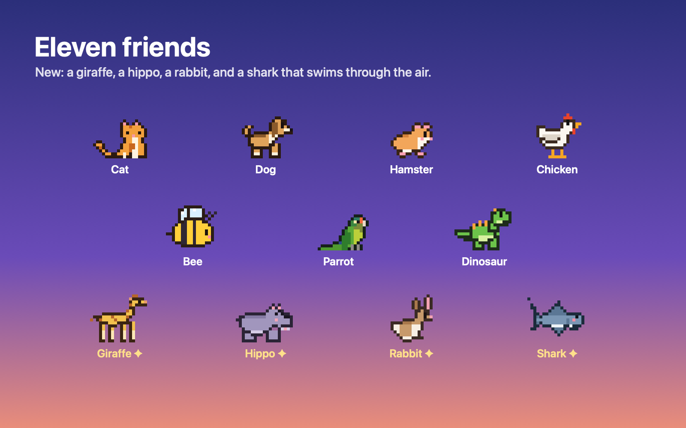 |
| 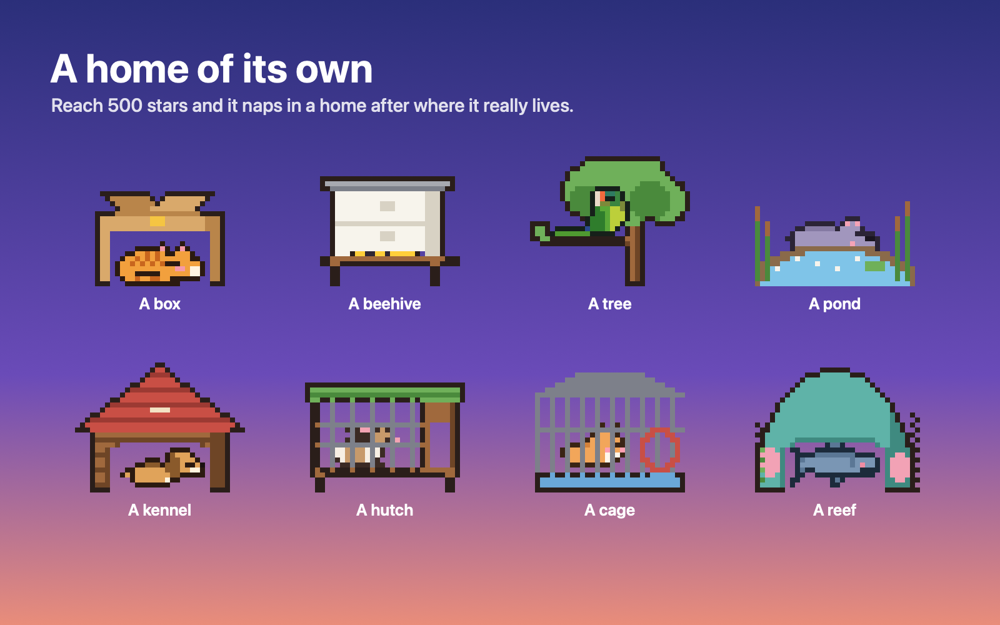 | 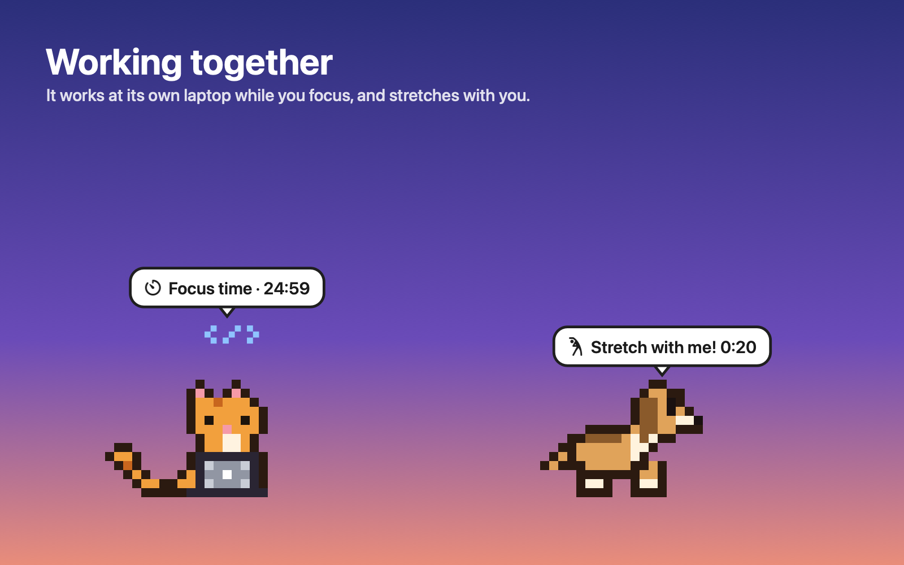 |
| 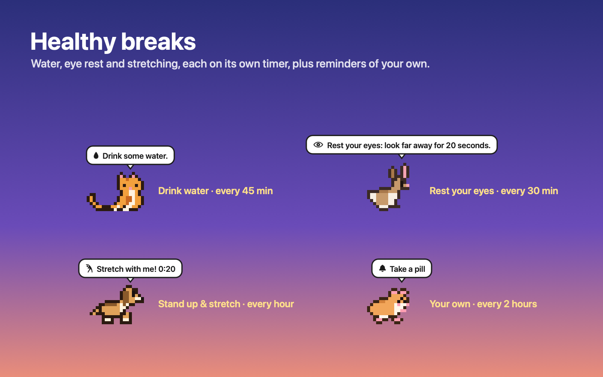 | 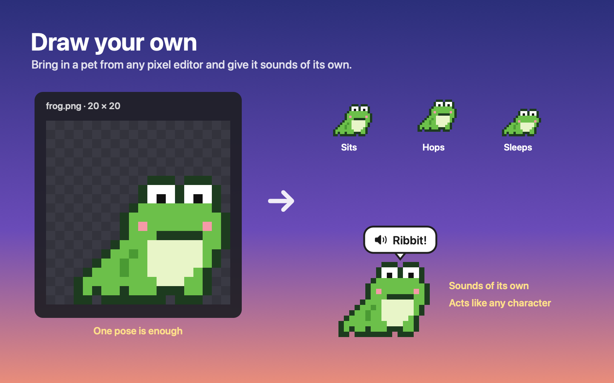 |
| 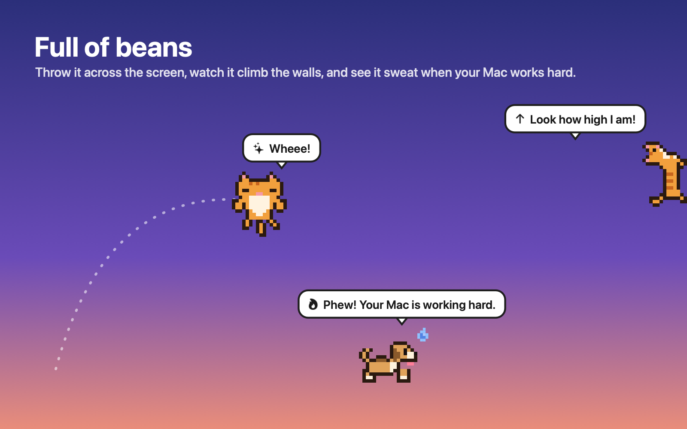 | 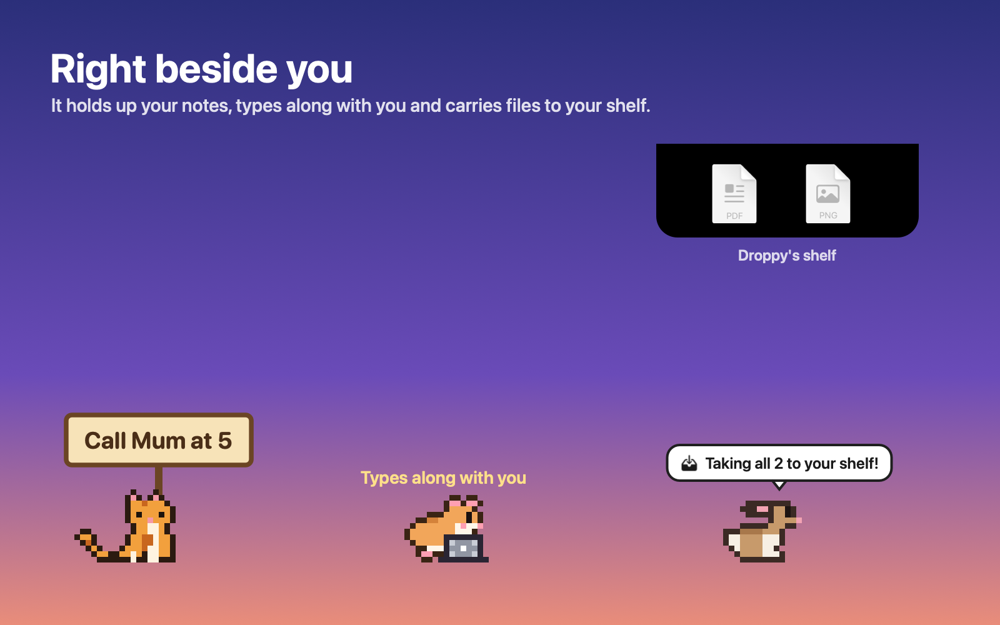 |
| 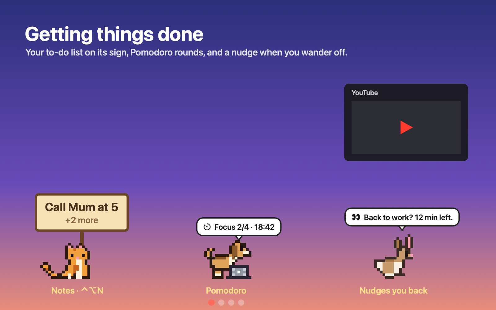 | 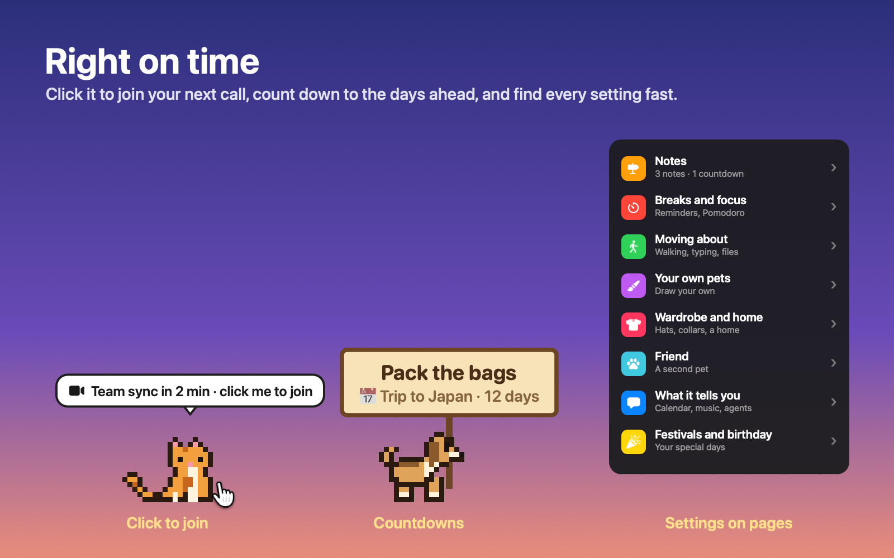 |
| 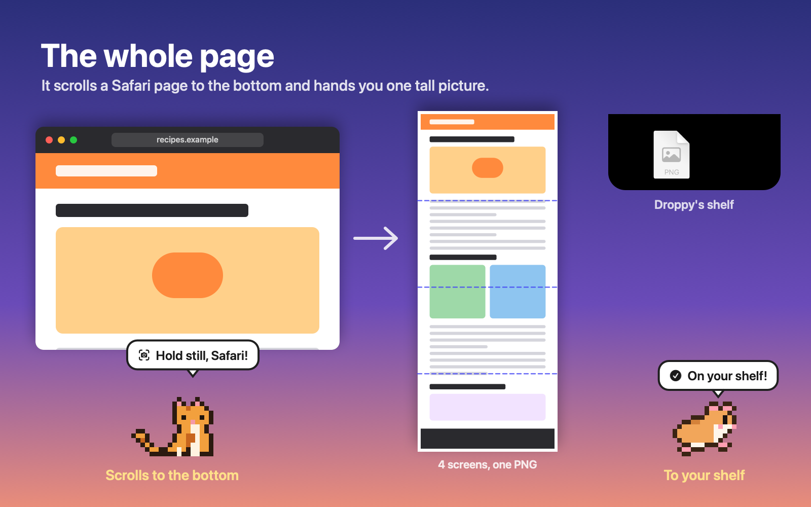 | 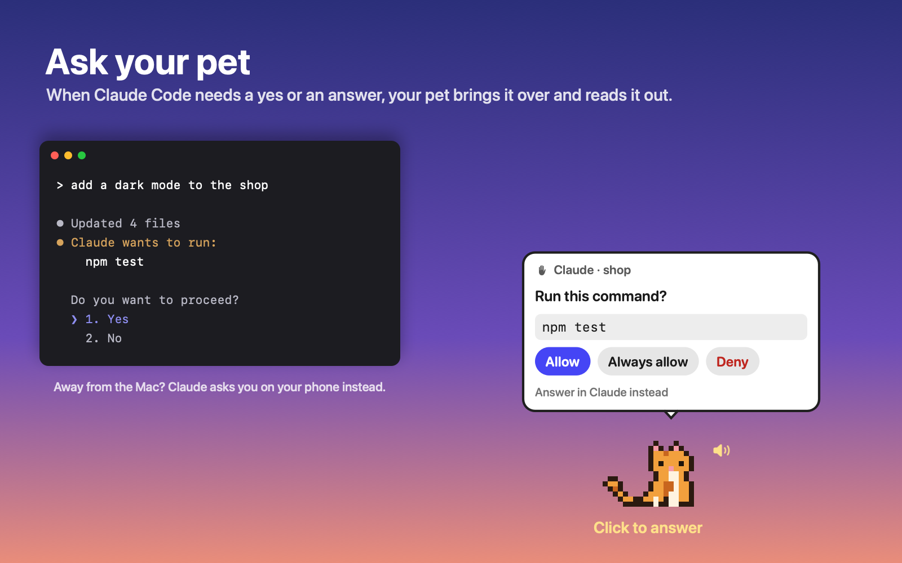 |
| 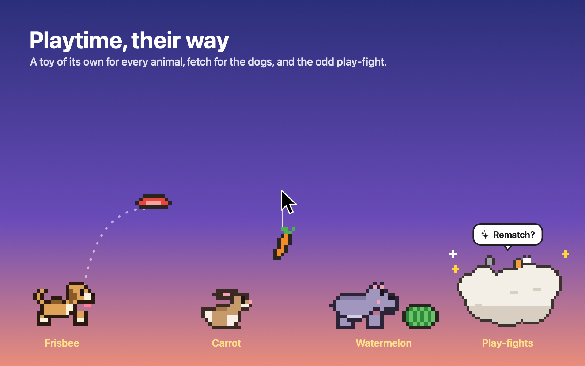 | 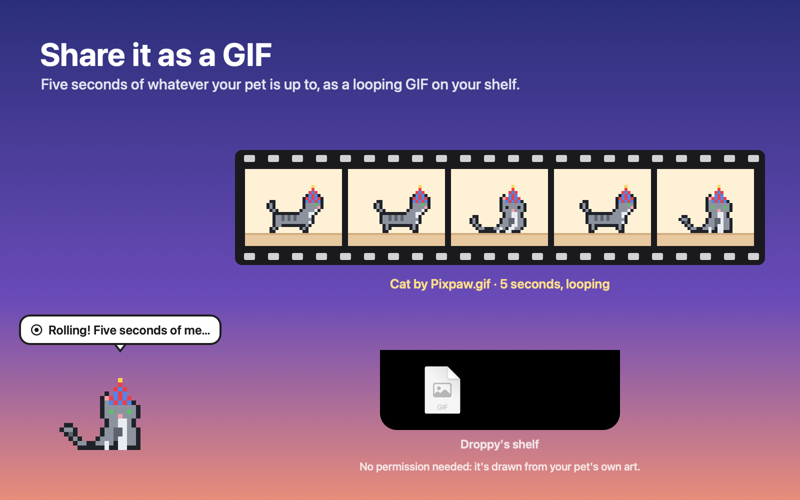 |
| 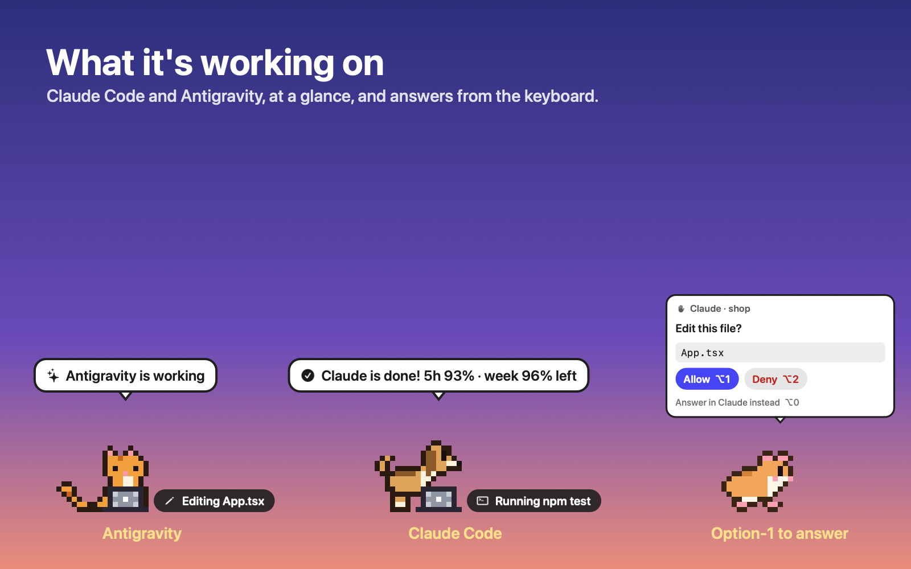 | |

Everything runs on your Mac. Notification text is shown and forgotten;
nothing is stored or sent anywhere.

## Updates

From 1.5.0, Pixpaw looks here for a newer release whenever you open its page
in Droppy's Settings, and offers an **Update** button; **Check for updates** in
its options menu looks straight away. Updating keeps your pet, stars, hats and
settings. Droppy asks you to approve each new version before it runs, and the
update takes effect after Droppy restarts. Coming from 1.4.0 or earlier,
install 1.5.0 by hand once.

## Building

You need macOS 14 or later, Xcode with Swift 6.2 or later, the
[DroppyKit](https://gitlab.com/droppyformac1/droppykit) SDK on your `PATH`,
and [Droppy](https://getdroppy.app) or the free
[Droppy Playground](https://getdroppy.app/download/playground).

```bash
droppykit build      # .build/Pixpaw.droplet
droppykit validate   # the checks the Droplet Store runs
droppykit run        # open it in the DroppyKit harness
```

Then drop `.build/Pixpaw.droplet` on Droppy Playground's Store page, or on
Droppy's Settings → Store → Local droplets.

## Coding agents

The cat says when a coding agent starts, finishes or needs you. Agents report
through `Tools/agent-hooks/pixpaw-agent.sh <name> <working|done|waiting|error> [text]`,
which opens `droppy-playground://droplet/pixpaw/agent?…` in the background
(set `PIXPAW_SCHEME=droppy` for Droppy itself).

- **Claude Code**: hooks in `~/.claude/settings.json`: `UserPromptSubmit` →
  `pixpaw-agent.sh Claude working`, `Stop` → `… done`, `Notification` →
  `… waiting`. For the usage left, set `Tools/agent-hooks/claude-statusline.sh`
  as the `statusLine` command: Claude Code only hands its rate limits to a
  status line, which saves them for the Stop hook to read.
- **Antigravity** (the app, the IDE and the `agy` CLI): install the Pixpaw
  plugin once, `agy plugin install /path/to/Tools/agent-hooks/antigravity`,
  and restart Antigravity. It says when a turn starts, finishes (with the plan
  usage left for the models in use, from `agy -p /usage`) or fails, puts
  what it's working on on the tag at your pet's side, and brings your
  Automations' results (the scheduled tasks in `~/.gemini/config/sidecars`).
  Its hooks print nothing, so Antigravity decides about every tool exactly as
  it would without them. Answering Antigravity from the pet's card isn't
  there yet: a hook can't yet let a command through for you.
- **Codex**: `notify = ["/path/to/Tools/agent-hooks/codex-notify.sh"]` in
  `~/.codex/config.toml`. It passes the event on to `PIXPAW_CODEX_NEXT`, or to
  Codex Computer Use's notifier when that is installed, so an existing
  `notify` keeps working.
- **Cursor**: `beforeSubmitPrompt` → working, `stop` → done.

**What it's working on.** Add a `PreToolUse` hook → `pixpaw-agent.sh Claude tool`
and a tag at your pet's side says what Claude is doing right now ("Editing
CatController.swift", "Running swift build"). The hook passes on the tool's name
and its file, command or address; Pixpaw shows only the file's name and the
command's first words.

```json
"PreToolUse": [{"matcher": "Edit|MultiEdit|Write|NotebookEdit|Read|Bash|Grep|Glob|WebFetch|WebSearch|Task|Agent",
  "hooks": [{"type": "command", "timeout": 5,
  "command": "PIXPAW_SCHEME=droppy /path/to/Tools/agent-hooks/pixpaw-agent.sh Claude tool"}]}]
```

**Scheduled runs.** The same hooks tell a scheduled run from your own:
`scheduled.py` matches the prompt against your Claude app scheduled tasks
(`~/.claude/scheduled-tasks/*/SKILL.md`) and the session's `/loop` crons, and
adds the task's name and, when it's done, the first line of its result. Your
pet says when one starts and comes over with the result when it finishes,
keeping it on its sign. For failures, add `StopFailure` →
`pixpaw-agent.sh Claude error`. Scheduled tasks in the cloud never run on your
Mac, so they can't reach it.

**Answer from your pet.** With `Tools/agent-hooks/pixpaw-ask.py` as a Claude Code
hook, a permission prompt (run this command? edit this file?) or a question with
a few answers comes to your pet: it reads it out and holds up the choices on a
card, and the one you click goes back to Claude. When the pet isn't out, you're
away from the Mac (no input for a minute, or the screen locked: handy with
Remote Control, which then asks you on your phone at once), or you don't
answer within PIXPAW_ASK_WAIT seconds (110), Claude asks you as usual. While
the card is up, Option-1 to Option-4 pick an answer and Option-0 hands it back.

```json
"PermissionRequest": [{"hooks": [{"type": "command", "timeout": 120,
  "command": "PIXPAW_SCHEME=droppy python3 /path/to/Tools/agent-hooks/pixpaw-ask.py"}]}],
"PreToolUse": [{"matcher": "AskUserQuestion", "hooks": [{"type": "command", "timeout": 120,
  "command": "PIXPAW_SCHEME=droppy python3 /path/to/Tools/agent-hooks/pixpaw-ask.py"}]}]
```

## Links for scripts and Shortcuts

`droppy://droplet/pixpaw/<action>` (or `droppy-playground://…`): `show`, `hide`,
`come`, `nap`, `feed`, `play?toy=yarn|teaser|laser|ball|mouse|frisbee|bigbone|seed|carrot|worm|bell|flower|leaves|watermelon|fish|stop`, `wear?hat=…&collar=…`,
`quiet?on=1|0`, `say?text=…`, `sign?text=…` (no text puts it down), `agent?name=…&state=…&text=…&usage=…`,
`note?text=…`, `join` (your next video call), `countdown?title=…&date=2026-12-24`,
`capture` (the whole page in your browser), `gif` (five seconds of your pet as a GIF), `agent?name=…&state=tool&tool=…&target=…` (used by the tool hook), `ask?id=…` (used by pixpaw-ask.py), `roam?mode=anywhere|floor|windows`,
`character?name=cat|bee|parrot|dino|dog|hamster|chicken|giraffe|hippo|rabbit|shark`.

## Art

Every character is a PNG sprite sheet in `Art/`, ready to open in any pixel
editor; [Art/README.md](Art/README.md) has the layout and the colours.
`Tools/sprites.py` reads the sheets, keeps the effects, hats and headphones as
small text grids, previews it all (`python3 Tools/sprites.py preview out.png`,
`… wear out.png`) and writes `Sources/Pixpaw/CatSprites.generated.swift`
(`python3 Tools/sprites.py swift`).
`Tools/store-art.swift` draws the screenshots and the creator avatar from
the same sprites.

The droplet's Store icon is designed by Droppy; `Pixpaw.icon` here is only
for local builds.

## Licence

MIT. See [LICENSE](LICENSE).
