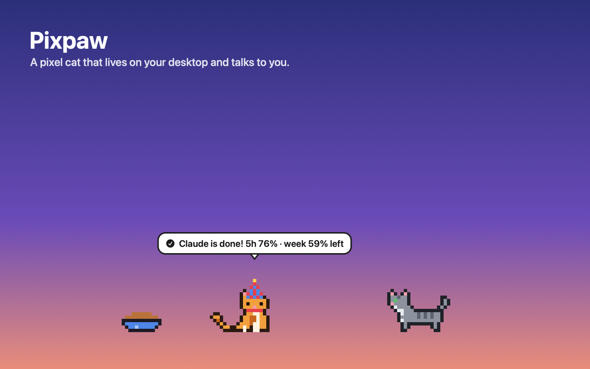
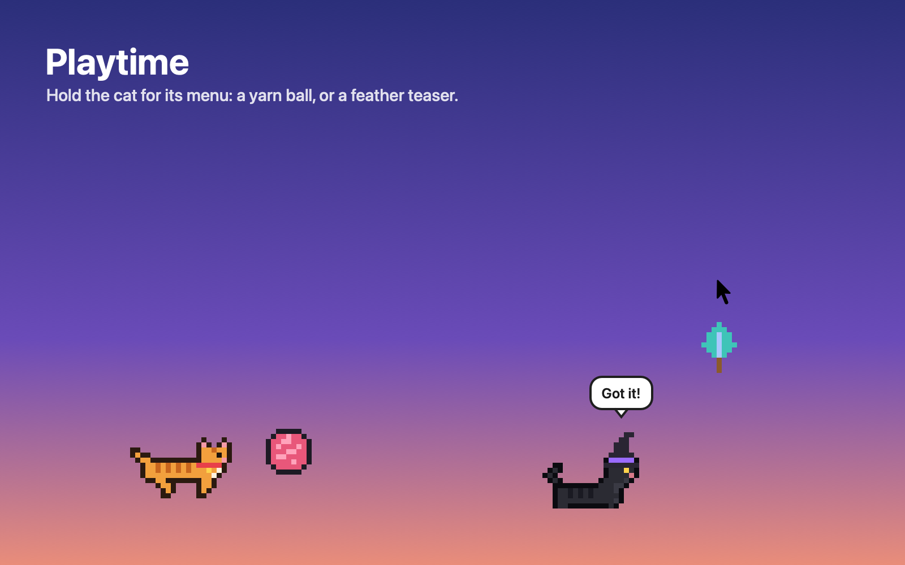
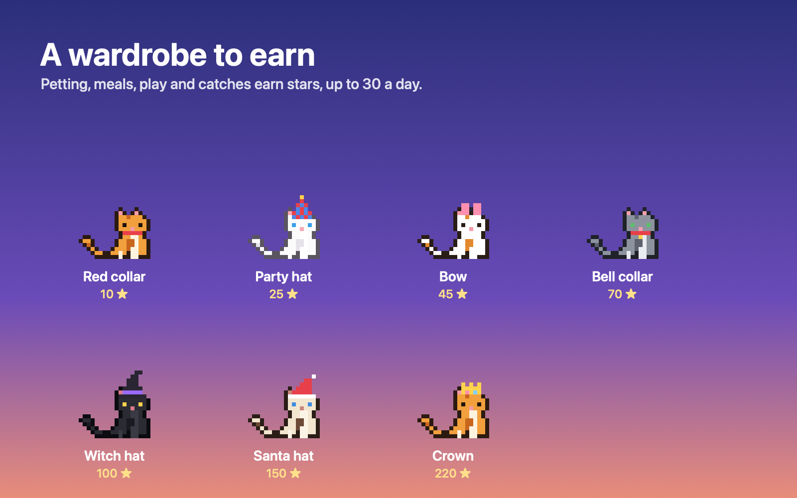
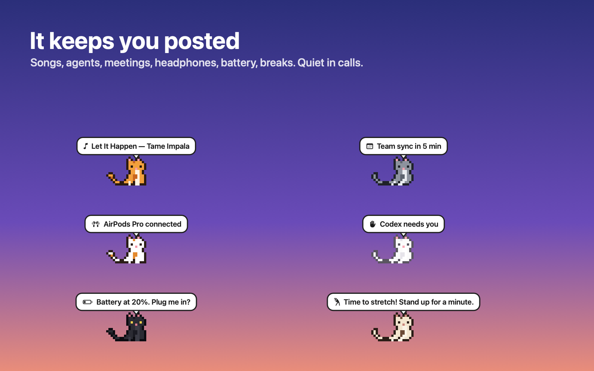

# Pixpaw 🐾

A pixel cat (or bee, parrot, dinosaur, dog, hamster or chicken) that lives on
your desktop and talks to you. A Droplet for
[Droppy](https://getdroppy.app), built with
[DroppyKit](https://getdroppy.app/docs/droppykit).



## What it does

**Lives on your desktop**
- Walks the bottom edge, the whole screen, or hops onto the tops of your
  windows, and rides along when you drag one. Movement follows the display's
  refresh, so it glides.
- Grooms, purrs when petted, pounces on files you drag, and dangles like a
  real cat when you pick it up.
- Hold it for half a second for its menu: Feed, Nap, Play (a yarn ball, a
  feather teaser or a laser pointer it never quite catches) and Wardrobe.
- Says good morning the first time it sees you each morning, with your first event of the day.
- Celebrates your birthday with confetti and a party hat.
- From midnight to 5 am it wears a nightcap and, once a night, tells you it's late.
- Strikes a pose when you take a screenshot.
- Stroke it with the pointer to pet it; shake it about and it lands dizzy.
- Treats, a little gift for you once a day, and a photo of your pet to keep or share.
- Focus sessions: it keeps you company quietly, with a countdown over its head and beside the notch.
- Festival hats, and Loy Krathong and Chinese New Year among the festivals.
- The shelf widget counts your days together, pets, meals and games.
- Six coats, and an optional friend cat that sits with it and plays tag.
- Not a cat person? Pick a bee (flies anywhere), a parrot (perches and flies
  between perches), a dinosaur, a dog, a hamster or a chicken, each with its
  own sounds. Switch from the portrait on the shelf or in Settings.
- Wears headphones while yours are connected.

**Talks in a speech bubble**
- Mac notifications, and calendar events five minutes ahead.
- Song changes in Apple Music and Spotify (and it stops to dance on every new song). It dances to anything else playing too: YouTube in your browser, a video, another player.
- Claude Code and Codex finishing or needing you, with the plan usage left.
- Volume and brightness, headphones connecting, the battery, downloads.
- Goes quiet during calls and screen sharing, and optionally while mirroring.

**Little extras**
- Happiness stars (petting, meals, play, catches; up to 30 a day) unlock
  pixel hats and collars.
- Break reminders every 30 to 90 minutes: stretch, drink water, rest your eyes.
- A hunger meter and a food bowl.
- Synthesised sounds (meow, purr, buzz, bark, squeak and more); no sound files.
- A shelf widget with its mood, stars, coats and quick controls.
- Festival decorations on the real dates only: ghosts on Halloween, fireworks
  at New Year, snow at Christmas, water drops for Songkran, hearts on
  Valentine's Day. Each can be switched off in Settings.

| | |
|---|---|
|  |  |
|  | |

Everything runs on your Mac. Notification text is shown and forgotten;
nothing is stored or sent anywhere.

## Building

You need macOS 14 or later, Xcode with Swift 6.2 or later, the
[DroppyKit](https://gitlab.com/droppyformac1/droppykit) SDK on your `PATH`,
and [Droppy](https://getdroppy.app) or the free
[Droppy Playground](https://getdroppy.app/download/playground).

```bash
droppykit build      # .build/Pixpaw.droplet
droppykit validate   # the checks the Droplet Store runs
droppykit run        # open it in the DroppyKit harness
```

Then drop `.build/Pixpaw.droplet` on Droppy Playground's Store page, or on
Droppy's Settings → Store → Local droplets.

## Coding agents

The cat says when a coding agent starts, finishes or needs you. Agents report
through `Tools/agent-hooks/pixpaw-agent.sh <name> <working|done|waiting|error> [text]`,
which opens `droppy-playground://droplet/pixpaw/agent?…` in the background
(set `PIXPAW_SCHEME=droppy` for Droppy itself).

- **Claude Code**: hooks in `~/.claude/settings.json`: `UserPromptSubmit` →
  `pixpaw-agent.sh Claude working`, `Stop` → `… done`, `Notification` →
  `… waiting`. For the usage left, set `Tools/agent-hooks/claude-statusline.sh`
  as the `statusLine` command: Claude Code only hands its rate limits to a
  status line, which saves them for the Stop hook to read.
- **Codex**: `notify = ["/path/to/Tools/agent-hooks/codex-notify.sh"]` in
  `~/.codex/config.toml`. It passes the event on to `PIXPAW_CODEX_NEXT`, or to
  Codex Computer Use's notifier when that is installed, so an existing
  `notify` keeps working.
- **Cursor**: `beforeSubmitPrompt` → working, `stop` → done.

## Links for scripts and Shortcuts

`droppy://droplet/pixpaw/<action>` (or `droppy-playground://…`): `show`, `hide`,
`come`, `nap`, `feed`, `play?toy=yarn|teaser|laser|stop`, `wear?hat=…&collar=…`,
`quiet?on=1|0`, `say?text=…`, `agent?name=…&state=…&text=…&usage=…`,
`roam?mode=anywhere|floor|windows`,
`character?name=cat|bee|parrot|dino|dog|hamster|chicken`.

## Art

Every character is a PNG sprite sheet in `Art/`, ready to open in any pixel
editor; [Art/README.md](Art/README.md) has the layout and the colours.
`Tools/sprites.py` reads the sheets, keeps the effects, hats and headphones as
small text grids, previews it all (`python3 Tools/sprites.py preview out.png`,
`… wear out.png`) and writes `Sources/Pixpaw/CatSprites.generated.swift`
(`python3 Tools/sprites.py swift`).
`Tools/store-art.swift` draws the screenshots and the creator avatar from
the same sprites.

The droplet's Store icon is designed by Droppy; `Pixpaw.icon` here is only
for local builds.

## Licence

MIT. See [LICENSE](LICENSE).
